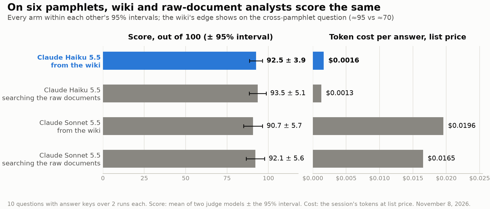

# Knowledge Wiki from Photographed Pamphlets

This project takes vendor pamphlets photographed at a conference, OCRs them into text, and has a team of Claude agents distill them into a **knowledge wiki** — a store of linked Markdown files where every claim has a source, aliases are merged, and conflicts stay flagged. Analyst agents then answer questions from the wiki instead of re-reading the raw documents, which is both cheaper and more accurate than searching the originals each time.

It is built on Claude [Managed Agents](https://platform.claude.com/docs/en/managed-agents/memory) and [dynamic workflows](https://platform.claude.com/docs/en/managed-agents/multiagent-orchestration#dynamic-workflows).

## What the agent does

The build runs as **one session**: you send a single message describing the goal, and a lead agent (`wiki-builder`) writes a workflow from it, starts the run, and reports. The workflow puts four kinds of worker agents on the pamphlets, in phases:

| Agent | Phase | How many | What it does |
| --- | --- | --- | --- |
| `wiki-extractor` | Extract | One per batch, in parallel | Reads its batch of pamphlet text in full and files entities, relations, metrics, and open questions by the schema |
| `wiki-resolver` | Resolve | One | Works the top open questions the extractors flagged — checking the wiki first, then the documents — and answers with a source or marks the gap unresolvable |
| `wiki-analyzer` | Analyze | One per batch, in parallel | Checks what was filed against the source documents |
| `wiki-organizer` | Organize | One | Tidies the whole wiki: merges duplicates, fixes links, updates the index |

The result is a memory store with `entities/`, `relations/`, `metrics/`, `open_questions/`, an `_index.md` catalog, and `escalations.md` for flagged items. The extractors follow rules that matter for messy sources like these: one entity file per real-world thing with all its names as aliases, superseded facts closed with `valid_to` rather than deleted, operative language quoted word for word, and "not in this document" recorded instead of global absence claims.

To query it, analyst agents mount the wiki **read-only**, one fresh session per question. They navigate the wiki's layout (index map first, then only the sections needed), cite every fact, and say "Not in the wiki" on a miss. They cannot write to the wiki, so a guess at query time never becomes the next analyst's fact.

## The pamphlets

`my_pamphlets/` holds six photographed vendor pamphlets (AI gateway, identity, dev-platform, and security products). Because they are photos rather than digital PDFs, `convert_pamphlets.py` runs a three-tier OCR pipeline, cheapest first, stopping at the first tier that yields enough text:

1. **docling**, default OCR (local, free)
2. **docling + EasyOCR**, full-page forced OCR (local, free, slower)
3. **Claude vision** (API tokens — only when both local passes fail)

Each result is cleaned (embedded images stripped, common OCR confusions like `Al` → `AI` fixed) and written to `pamphlet_corpus/` as a `.txt` file with a `[SOURCE: ...]` provenance header, which is the format the wiki build expects.

## Repository layout

```
distill_documents_into_knowledge_wiki.ipynb   The main notebook: build the wiki, query it, measure cost
utilities.py                                  Helpers: normalization, batching, workflow tracking, reports
convert_pamphlets.py                          OCR pipeline: my_pamphlets/*.pdf -> pamphlet_corpus/*.txt
ask_wiki.py                                   Ask the existing wiki a question - no rebuild, ~$0.002/answer
benchmark.py                                  Wiki-vs-raw-documents benchmark over the pamphlet corpus
make_benchmark_chart.py                       Renders assets/wiki_benchmark.png from the benchmark results
benchmark_results.json                        Every benchmark answer, judge score and summary
prompts/                                      System prompts: lead agent, analyzer, organizer, baseline analyst
my_pamphlets/                                 The photographed pamphlet PDFs
pamphlet_corpus/                              OCR'd, provenance-stamped text ready for the wiki build
assets/                                       Diagrams and the benchmark chart
originals/                                    Original source material
```

## Running it

1. **Setup.** Python 3.11+, then `pip install -r requirements.txt`. Authenticate with a Claude API credential (`ANTHROPIC_API_KEY` in a `.env` file, or `ant auth login`). Managed Agents (beta) must be available to your API organization.
2. **Convert the pamphlets** (needs a docling venv at `~/.venvs/docling` for the local tiers):
   ```
   python convert_pamphlets.py                 # my_pamphlets/ -> pamphlet_corpus/
   python convert_pamphlets.py --force         # redo files whose .txt already exists
   ```
3. **Build and query the wiki.** Point the notebook at the pamphlet corpus and run it top to bottom:
   ```
   set COOKBOOK_DOCS=pamphlet_corpus
   jupyter lab distill_documents_into_knowledge_wiki.ipynb
   ```
   The notebook estimates the build cost before creating any agent and stops if it exceeds the budget (`COOKBOOK_BUDGET_USD`, default $60). Models for each agent role are also set by environment variable (`COOKBOOK_BUILD_MODEL`, `COOKBOOK_CONSOLIDATE_MODEL`, `COOKBOOK_QUERY_MODEL`, `COOKBOOK_LEAD_MODEL`); the defaults use Claude Haiku 5.5 for the readers and Claude Sonnet 5.5 for the lead agent.

## The benchmark



`benchmark.py` measures this corpus's wiki against the raw pamphlet texts: 10 questions with answer keys, asked twice each by four analyst arms (Claude Haiku 5.5 and Claude Sonnet 5.5, each answering from the read-only wiki store and from the raw documents), every answer scored 0–100 against the key by two judge models (Sonnet and Opus). Results from the November 8, 2026 run, with the token cost of one answer at list price:

| Analyst | Score (± 95%) | Cost per answer |
| --- | --- | --- |
| Haiku 5.5 from the wiki | 92.5 ± 3.9 | $0.0016 |
| Haiku 5.5 searching the raw documents | 93.5 ± 5.1 | $0.0013 |
| Sonnet 5.5 from the wiki | 90.7 ± 5.7 | $0.0196 |
| Sonnet 5.5 searching the raw documents | 92.1 ± 5.6 | $0.0165 |

The honest readout: on a 32 KB, six-document corpus, every arm ties within the intervals, and raw search is already cheap — the wiki doesn't pay for itself on price at this size (the build cost about $0.43 once). Where it does show up is the cross-document question: asked which customer names appear in more than one pamphlet, wiki analysts score about 95 against about 70 for raw-document analysts, because the wiki already filed those connections at build time. It also shows the flip side — the wiki under-filed one product relationship (Halo Agent Studio as an add-on to the Halo control plane) and wiki analysts lost points there. Full answers and judge scores are in `benchmark_results.json`; re-run with `python benchmark.py` and re-chart with `python make_benchmark_chart.py`.

## Why bother with a wiki?

A search index finds passages, but the hardest facts come from *comparing* documents: two metrics with the same name, one company under three names, a figure a later document contradicts. The wiki works those out once, at build time, so every question afterward starts from reconciled, cited facts instead of raw text. On this small corpus that mostly buys accuracy on cross-document questions; the price advantage grows with the corpus, since a raw search has more to read while the wiki answer stays the same size.
